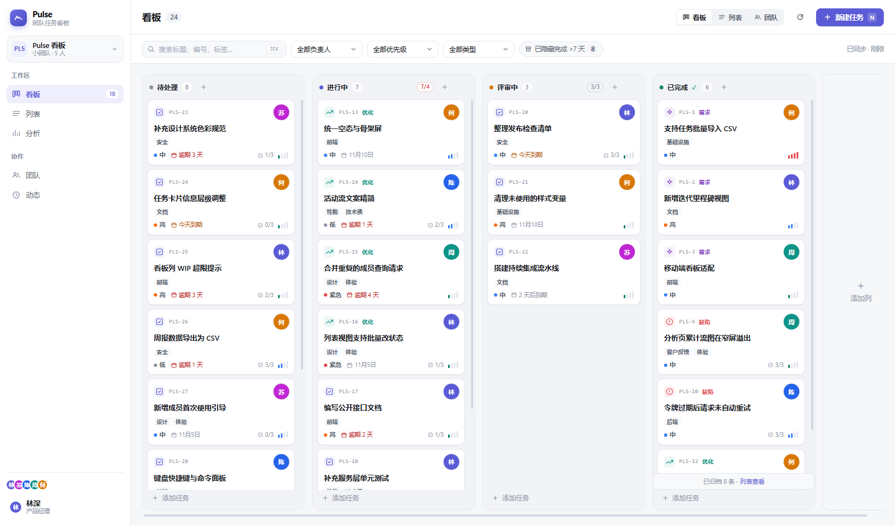
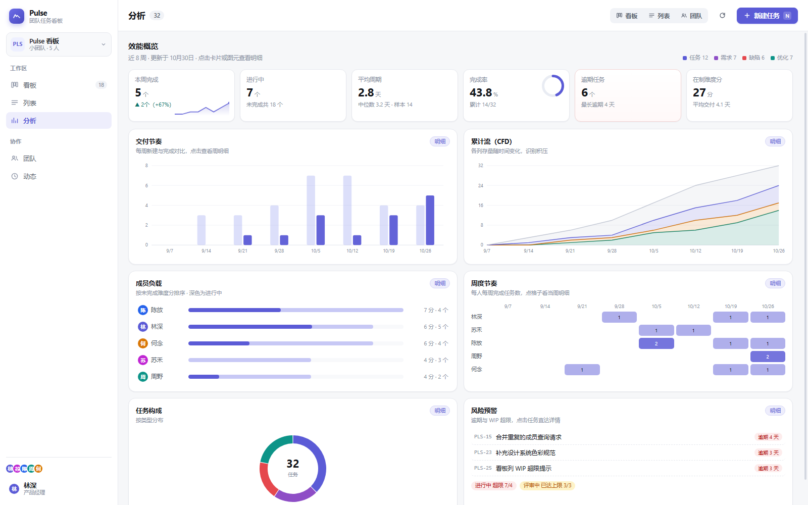

# Pulse · 小团队任务跟踪与效能看板

参考 JIRA 的任务模型与 Plane 的极简交互，为 5~10 人小团队设计的一体化任务看板：
看板拖拽流转、列表批量查看、周维度效能分析、团队动态时间线，全部零外部依赖，`node` 直接启动。



## 快速开始

```bash
# 需要 Node.js >= 22.5（内置 node:sqlite，无需 npm install）
npm start
# 打开 http://127.0.0.1:4173
```

数据保存在 `data/kanban.db`（SQLite，WAL 模式）。首次启动若检测到旧版 `data/db.json` 会自动迁移，
否则生成一份带 8 周历史轨迹的示例数据（32 个任务、5 位成员）。

自定义配置：`cp .env.example .env` 后修改端口、数据目录、CORS 白名单等。

常用命令：

| 命令 | 作用 |
|------|------|
| `npm start` | 启动服务（默认 127.0.0.1:4173） |
| `npm run dev` | 带 `--watch` 的开发模式，改后端自动重启 |
| `npm run reset` | 重置为示例数据（需先停服） |
| `npm run clear` | 清空任务与成员，保留看板列 |
| `npm run backup` / `npm run restore` | 数据库快照备份 / 恢复 |
| `npm run package` | 构建 `dist/kanban-pulse-<版本>.tar.gz|zip` |
| `npm run snapshot -- "feat: 说明"` | 验收后提交一个版本点（见「版本管理约定」） |

## 生产部署

```bash
node scripts/build-package.mjs   # 生成 dist/ 下的部署包（tar.gz + zip + SHA256SUMS）
```

三种部署方式任选（详见 **[部署与运维手册](docs/DEPLOYMENT.md)**）：

| 方式 | 适合场景 | 入口 |
|------|----------|------|
| Docker Compose | 有 Docker 的服务器（推荐） | `docker compose up -d --build` |
| systemd | Linux 裸机常驻 | `deploy/kanban-pulse.service` |
| Windows | 双击即用 | `deploy/start.bat` |

日常运维：

```bash
npm run backup                        # 备份数据（SQLite 一致性快照，gzip，自动滚动清理）
npm run restore -- backups/xxx.db.gz  # 恢复备份（先停服务）
npm run clear -- --yes                # 清空所有任务与动态（保留成员与看板列）
```

产品功能与操作说明见 **[使用说明](docs/USER-GUIDE.md)**。

> 生产环境默认空库启动（`SEED_MODE=empty`，仅一名管理员）；当前版本无登录鉴权，请部署在内网或网关认证之后。

## 功能

**看板**
- 四列流转：待处理 → 进行中 → 评审中 → 已完成，列内拖拽排序、跨列拖拽改状态
- **默认查询条件**：完成超过 7 天的任务自动从看板隐藏（筛选栏右侧显示「已隐藏完成 >7 天 N」，
  一次点击即可临时显示全部；完成列底部也会提示「已归档 N 条 · 列表查看」）
- **看板列自定义**：新增列、编辑列名/配色/WIP 上限、左右移动排序、删除列（名下任务自动转移到指定列，
  历史记录同步改写；删除「完成列」时语义自动继承给目标列），最多 12 列，至少保留一个完成列
- 列头 WIP 上限提示，超限变红
- 列内快速创建（回车提交），空列有明确落点
- **任务卡按信息层级重排**（v1.11）：
  - 顶部：类型图标（14px，按类型配色；非「任务」类型额外显示类型名）+ 任务键 + **28px 处理人头像**
  - 中间：标题（2 行截断）+ 标签（最多 2 个，其余折成 +N）
  - 底部：优先级（色点+文字）、截止状态（逾期红 / 临期橙，无截止不占位）、子项完成度、
    难度 4 格刻度（悬停显示「简单/一般/较难/困难」）
  - 未指派显示虚线圈，点头像即可换人；点到卡片主体打开详情抽屉

**新建任务**
- 弹框中描述同样支持 Markdown：编辑 / 预览一键切换
- 标签可现场自定义（回车新建），最多 8 个

**列表**
- 展示全部任务（含看板默认隐藏的超期完成任务），可与搜索、负责人/优先级/类型筛选叠加
- 表头排序（状态、优先级、负责人、截止、难度、开始时间、更新时间）
- 行内状态下拉直接流转，点击行打开详情

**任务详情抽屉**
- 标题/描述即时保存，属性区可改状态、优先级、负责人、截止日期、**难易程度（下拉）**、类型
- **描述支持 Markdown**：默认渲染预览，点「编辑」切到源码，失焦即保存；
  支持标题、粗体/斜体/删除线、行内代码、代码块、有序/无序列表、任务清单、表格、引用、分割线、链接
  （零依赖渲染器，先转义再格式化，链接仅允许 http/https/mailto）
- **时间信息**：创建 / 开始 / 完成三个时间点 + 周期天数；**开始与完成时间可直接编辑**
  （留空即设为未开始/未完成），修改会写入活动记录并同步影响周期与周度统计
- 标签多选 + **自定义标签**：输入框回车即可新建，内置标签与历史用过的自定义标签都会出现在候选里
- 子项增删勾选（带完成度进度条）、任务级活动记录、删除二次确认

**分析**（卡片优先，点开看明细）



- **时间范围可切 4 / 8 / 12 周**：趋势图、累计流、热力与周度表同步刷新
- 6 张 KPI 卡：本周完成（**对比上周同期** + 迷你趋势线）、进行中、平均周期（中位数/样本）、
  完成率（环形进度）、逾期（最长逾期天数）、在制难度分；每张卡标题后的「?」悬停看统计口径
- 6 张图形卡：交付节奏（周新建 vs 完成）、累计流 CFD、成员负载（进行中占比）、
  周度节奏热力、任务构成（环图）、风险预警（逾期 + WIP 超限/已达上限）
- **点击任意卡片/格子/成员行 → 明细弹框**：任务清单、周期分布、周度表、WIP 状态；
  表格里再点一行直接打开任务抽屉，卡片内逾期条目一键直达详情
- 统计口径：默认近 8 周、周一为起点；「本周完成」同比取上周同一时段而非整周；
  成员维度按任务「当前负责人」归属，未指派单列

**团队（成员维护）**
- 成员卡片：姓名、角色、邮箱、头像色，附在办/进行中/已完成/逾期统计与工作量占比条
- 卡片右上角常驻 **✎ 编辑** 与 **🗑 删除** 按钮：编辑可改姓名/角色/邮箱/头像色；删除时可选择「转交给指定成员」或「转为未指派」
- 新增 / 编辑成员（姓名必填、同名拒绝、邮箱与颜色校验），头像颜色十色可选；仅剩一名成员时删除按钮自动禁用
- 删除成员时可选「转交给指定成员」或「转为未指派」，任务时间线保留指派变更记录
- 「待指派任务」面板汇总没有执行人的任务，一键弹出指派菜单
- 侧栏底部「当前操作人」点击（或悬停出现铅笔图标）可直接编辑我的信息；成员头像组点击进入团队页

**执行人切换**
- 看板卡片右上角头像即切换入口：弹出菜单列出成员及其在办数量，选中即保存
- 列表页负责人列内联下拉直接切换
- 任务抽屉、新建任务弹窗均可指定负责人；所有指派变更写入任务历史与活动流

**协作**
- 全局动态时间线按天分组，点击跳转对应任务
- 所有变更写入活动流，带操作者与时间

**工程能力**
- SQLite 存储（Node 内置 `node:sqlite`，WAL 模式，写操作走事务，版本化 schema 迁移，旧 JSON 数据自动迁移）
- 搜索（标题/编号/描述/标签）+ 负责人/优先级/类型筛选
- 快捷键：`N` 新建、`⌘/Ctrl + K` 搜索、`Esc` 关闭
- 离线提示、请求失败重试（GET 最多 3 次指数退避）、5xx 与 4xx 分流处理
- 静态资源带 ETag 协商缓存（no-cache + 304），前端发版后浏览器强制拿到最新代码，不会卡在旧页面
- 响应式布局（≤1180px 收窄侧栏；≤820px 隐藏侧栏，顶栏保留 看板/列表/团队 切换）

## 目录结构

```
.github/workflows/ci.yml   # CI：语法检查 → 启动冒烟 → 部署包构建
.github/                   # （如需）Issue / PR 模板
.githooks/pre-commit       # 提交前钩子：node --check + 敏感文件拦截
docs/                      # 使用手册、部署手册、开发工作流、设计文档；配图在 docs/assets/
deploy/                    # systemd / nginx / PM2 / Windows 启动脚本
scripts/                   # 备份恢复、打包、快照提交、数据重置
server/
  index.js                 # 启动、中间件编排、优雅停机（checkpoint + 关库）
  config.js                # 环境变量集中校验（启动即失败）
  domain.js                # 看板列/优先级/类型等共享枚举
  errors.js                # 类型化错误 + 校验器
  logger.js                # 结构化 JSON 日志
  seed.js                  # 示例数据（含历史轨迹）
  db/database.js           # SQLite 连接、PRAGMA、版本化迁移、事务
  db/seed.js               # 初始化：旧 JSON 迁移 / 示例数据 / 空库
  http/router.js           # 极简路由（路径参数）
  http/respond.js          # 响应封装、错误出口、限流
  http/middleware.js       # 安全头、CORS、静态资源
  repositories/            # SQL 存取与查询（columns/tasks/members/activity/project）
  services/columnService.js    # 看板列业务规则（增删改移、任务转移、语义继承）
  services/taskService.js  # 任务业务规则
  services/analyticsService.js # 指标计算
  routes/api.js            # 端点定义
public/
  index.html               # 应用外壳
  css/style.css            # 设计系统
  js/app.js                # 路由、筛选、快捷键
  js/state.js              # 单一状态源与数据操作
  js/api.js                # 类型化请求封装（重试/错误映射）
  js/views/                # 看板 / 列表 / 分析 / 团队 / 动态
  js/assignee.js           # 执行人快速切换菜单
  js/drawer.js             # 任务详情
  js/modal.js              # 新建任务、成员维护、确认弹窗
  js/charts.js             # 手写 SVG 图表
```

> 根目录的验收截图、`dist/`、`data/`、`backups/`、`.env` 均不入库（见 `.gitignore`）；
> 需要长期保留的文档配图请放 `docs/assets/`。

## 代码质量与 CI

| 环节 | 内容 |
|------|------|
| 提交前（本地） | `.githooks/pre-commit`：对暂存的 `.js/.mjs` 跑 `node --check`，拦截 `.db/.env/.log` |
| 持续集成 | GitHub Actions `CI`：全量 JS 语法检查 → 以临时数据目录启动服务并校验 `/api/health`、`/api/bootstrap`、`/api/analytics` → `npm run package` 构建验证 |
| 本地等价命令 | 见下表 |

```bash
# 语法检查（与 CI 一致）
git ls-files '*.js' '*.mjs' | while read f; do node --check "$f"; done

# 启动冒烟（隔离数据，不污染 data/）
NODE_ENV=development PORT=4199 DATA_DIR=.ci-data SEED_MODE=demo npm start &
curl -sf http://127.0.0.1:4199/api/health
```

## API

统一响应结构：成功 `{ "data": ... }`，失败 `{ "error": { code, message, details, requestId } }`。
写操作通过 `X-Actor-Id` 头标识操作者；`actorId` 会写入活动流。

| 方法 | 路径 | 说明 |
| --- | --- | --- |
| GET | `/api/health` | 健康检查 |
| GET | `/api/bootstrap` | 首屏数据（项目、成员、任务、动态、枚举） |
| GET | `/api/tasks` | 任务列表，支持 `status/assigneeId/priority/type/q` |
| POST | `/api/tasks` | 创建任务 |
| PATCH | `/api/tasks/:id` | 局部更新（字段白名单校验）；支持 `startedAt` / `completedAt` 手工修正（ISO 或 `YYYY-MM-DDTHH:mm`，传 `null` 清空，不允许未来时间且完成不得早于开始） |
| POST | `/api/tasks/:id/move` | 移动/排序 `{ status, index }` |
| DELETE | `/api/tasks/:id` | 删除任务 |
| POST | `/api/tasks/:id/subtasks` | 新增子项 |
| PATCH | `/api/tasks/:id/subtasks/:sid` | 切换子项完成状态 |
| DELETE | `/api/tasks/:id/subtasks/:sid` | 删除子项 |
| GET | `/api/analytics` | 全部分析指标 |
| GET | `/api/activity?limit=` | 活动流 |
| GET | `/api/members` | 成员列表（含负载统计） |
| POST | `/api/members` | 新增成员 `{ name, role?, email?, color? }` |
| PATCH | `/api/members/:id` | 更新成员信息 |
| DELETE | `/api/members/:id?reassignTo=` | 删除成员，名下任务转交或转为未指派 |
| GET | `/api/columns` | 看板列列表（含各列任务数） |
| POST | `/api/columns` | 新增看板列 `{ name, tone?, wipLimit? }` |
| PATCH | `/api/columns/:id` | 编辑列 `{ name?, tone?, wipLimit? }` |
| POST | `/api/columns/:id/move` | 列排序 `{ index }` |
| DELETE | `/api/columns/:id?moveTo=` | 删除列，名下任务转移到指定列 |

## 关键设计

**分层**：控制器只解析请求/格式化响应，服务层承载业务规则（状态流转、完成时间、活动记录），
仓储层负责存取与排序。服务层不依赖 HTTP 对象，便于单测与替换存储。

**数据一致性**：SQLite（WAL 模式）是单一事实来源，写操作在事务内完成，进程退出时 checkpoint 并关闭数据库。
看板列支持自定义（增删改移、WIP 上限、完成/开始语义），任务状态流转依据列的 `isDone`/`isStart` 语义维护
`completedAt` 与 `history`，分析口径全部基于历史轨迹还原，而不是只看当前状态。

**分析口径**
- 开始时间 = 任务首次进入「开始列」及其后续列的时刻（落库 `startedAt`，老数据从历史回填；
  任务退回未开始列不会清空，保证周期口径稳定）
- 周期时间 = 开始时间 → 完成；前置时间 = 创建 → 完成
- CFD = 每周最后时刻按历史还原的各状态存量（不是当前状态反推）
- 吞吐量 = 每周新建数 / 完成数；趋势按周一为界，展示最近 8 周
- 成员周度统计按任务「当前负责人」归属；`startedAt` 缺失的历史任务回退到历史记录推断

**安全与稳健**：CORS 显式来源（生产禁通配符）、CSP 与安全响应头、每 IP 限流、
请求体大小限制、启动时校验配置、全局错误出口不泄露堆栈、日志携带请求 ID。

## 验证记录

- `GET /api/health`、`/api/bootstrap`、`/api/analytics` 返回正常
- 创建 → 更新（含状态流转，`completedAt` 正确写入）→ 移动排序 → 子项增删 → 删除，全链路通过
- 校验失败返回 422 并携带字段级明细；非法 JSON 400；不存在资源 404
- 看板列全链路：新增 → 编辑（名称/配色/WIP）→ 左右移动 → 删除（任务转移 + 历史改写 + 完成语义继承），
  同名/空名/坏配色/坏 WIP 422，删除最后一个完成列 422，不存在 404；无头浏览器驱动页面交互全流程通过
- 旧版 `data/db.json` → SQLite 自动迁移验证通过（4 列 / 5 成员 / 32 任务完整保留）
- 备份/恢复脚本基于 `VACUUM INTO` 快照，服务运行中备份、停服恢复均验证通过
- 成员接口全链路：新增 → 更新 → 指派任务 → 删除并转交（任务历史留下指派记录），
  重名 / 空名 / 坏颜色 / 坏邮箱 422，转交对象非法 400，不存在 404
- 团队页、成员弹窗、移除成员对话框、卡片指派菜单、列表内联指派均通过无头浏览器截图核对
- 生产部署包：`build-package.mjs` 产物 SHA256 校验通过，tar/zip 内容一致且 zip 兼容 Linux 解压；
  解包后以 `NODE_ENV=production` 冷启动验证（空库初始化、健康检查、静态页、备份/恢复脚本）
- Docker：镜像构建成功，容器健康检查 healthy，`/api/health`、首页与空库初始化均验证通过

## 开发与版本管理

仓库地址：<https://github.com/Shmming-86/pulse>，主分支 `main` 始终保持可发布状态。
**每次开发都在独立的 git worktree 中进行，验收通过后合并回 `main` 并自动提交、推送。**
完整流程见 [docs/WORKFLOW.md](docs/WORKFLOW.md)。

```bash
# ① 新建工作树（从最新 main 切出，目录在仓库同级 pulse-worktrees/ 下）
bash scripts/worktree.sh start feat/task-templates
cd ../pulse-worktrees/feat-task-templates

# ② 开发、自测后提交并推送功能分支
npm run snapshot -- "feat: 任务模板"

# ③ 验收通过：合并回 main、推送、清理工作树
cd /d/work/kanban
bash scripts/worktree.sh finish feat/task-templates "feat: 任务模板 (v1.8.0)"

# ④ 需要发布点时打标签
git tag -a v1.8.0 -m "说明" && git push origin v1.8.0
```

约定细则：

- **一功能一工作树**：分支用 `feat/fix/chore/refactor/docs/` 前缀，工作树放仓库同级的 `pulse-worktrees/`，不污染仓库目录
- **验收即提交即推送**：`npm run snapshot` 自动带版本号提交，并推送到 `origin` 的同名分支；
  加 `--no-push` 可只提交不推送
- **合并即发布**：`scripts/worktree.sh finish` 做 `merge --no-ff` + `push origin main` + 删工作树，
  合并前会校验功能分支与主工作区都没有未提交改动
- **提交前自动校验**：`.githooks/pre-commit` 会对暂存的 `.js/.mjs` 跑 `node --check`，
  并拦截 `.db/.env/.log` 等敏感文件；校验不通过直接阻止提交
- **不入库的内容**：`data/`（SQLite 数据）、`dist/`（部署包）、`backups/`、根目录 `*.png`（验收截图）、`.env`、`.workbuddy/`；
  文档配图放在 `docs/assets/` 并随文档一起入库
- 行尾统一 LF 存储（`deploy/start.bat` 等 Windows 脚本保持 CRLF），见 `.gitattributes`
- 首次克隆后启用钩子：`git config core.hooksPath .githooks`

## 后续可扩展

- 迭代（Sprint）与里程碑视图、燃尽图
- 成员账号与真实登录（当前用 `X-Actor-Id` 模拟）
- 评论与 @提醒、附件上传
- 存储切换 PostgreSQL（仓储层已隔离，替换实现即可）
- 任务拖拽的移动端手势支持

## 备注

- 数据保存在 `data/kanban.db`（SQLite），已在 `.gitignore` 中排除；`npm run reset` 可重置示例数据
- 端口冲突时改 `.env` 里的 `PORT`；跨端调用需把来源加入 `CORS_ORIGINS`
远程仓库已配置为 `origin`（<https://github.com/Shmming-86/pulse>）：

```bash
git push origin main --tags      # 补推主分支与所有版本标签
git fetch --all --tags           # 换机后拉取最新代码与标签
```

## 许可证

本项目采用 [Apache License 2.0](LICENSE) 授权，版权归属见 [NOTICE](NOTICE)。

- 允许商用、修改、分发与专利授权；分发时须保留 `LICENSE` 与 `NOTICE`，并标明修改过的文件
- 如调整版权主体，改 `NOTICE` 里的 `Copyright` 行即可，`LICENSE` 原文无需改动
